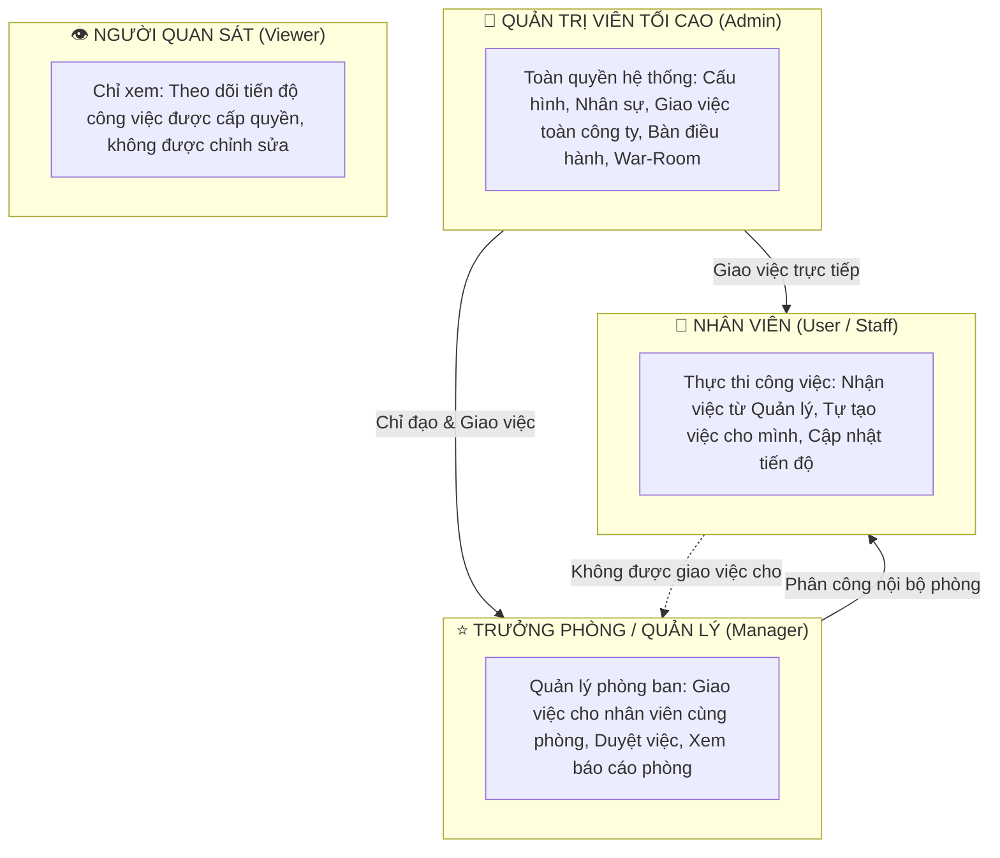
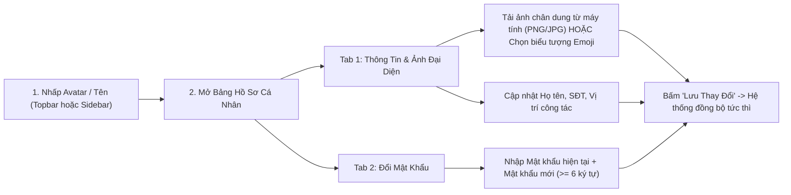
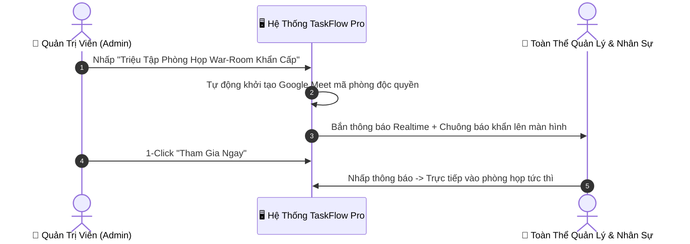

# CẨM NANG HƯỚNG DẪN SỬ DỤNG HỆ THỐNG TASKFLOW PRO
## Từ Cơ Bản Cho Người Mới Bắt Đầu Đến Quản Trị Viên Tối Cao (Super Admin)

---

## 📌 MỤC LỤC TỔNG QUAN

1. [Giới Thiệu Hệ Thống TaskFlow Pro](#1-giới-thiệu-hệ-thống-taskflow-pro)
2. [Cơ Cấu Phân Quyền & Ma Trận Thẩm Quyền](#2-cơ-cấu-phân-quyền--ma-trận-thẩm-quyền)
3. [Cẩm Nang Cho Người Mới Bắt Đầu (Cấp Độ 0)](#3-cẩm-nang-cho-người-mới-bắt-đầu-cấp-độ-0)
   - 3.1. Truy cập hệ thống & Các hình thức đăng nhập
   - 3.2. Làm quen giao diện làm việc
   - 3.3. Thiết lập Hồ sơ cá nhân, Avatar ảnh & Đổi mật khẩu
4. [Hướng Dẫn Dành Cho Nhân Viên (Role: User)](#4-hướng-dẫn-dành-cho-nhân-viên-role-user)
   - 4.1. Xem và lọc công việc được giao
   - 4.2. Tự tạo công việc cá nhân
   - 4.3. Cập nhật tiến độ: Checklist, Đính kèm tài liệu, Bình luận
   - 4.4. Kéo thả trạng thái công việc (Kanban Flow)
   - 4.5. Tham gia họp Google Meet gắn liền với công việc
5. [Hướng Dẫn Dành Cho Quản Lý / Trưởng Phòng (Role: Manager)](#5-hướng-dẫn-dành-cho-quản-lý--trưởng-phòng-role-manager)
   - 5.1. Quy trình giao việc cho nhân sự cấp dưới trong phòng ban
   - 5.2. Theo dõi đa góc nhìn: Kanban, Danh sách, Lịch biểu, Tiến độ Gantt
   - 5.3. Nghiệm thu & Duyệt kết quả công việc
   - 5.4. Quản lý hạn chót (Deadline) & Xử lý cảnh báo trễ hạn
6. [Hướng Dẫn Dành Cho Quản Trị Viên Tối Cao (Role: Admin / Super Admin)](#6-hướng-dẫn-dành-cho-quản-trị-viên-tối-cao-role-admin--super-admin)
   - 6.1. Bàn Điều Hành Lãnh Đạo (Executive Desk) & Trung tâm Chỉ huy
   - 6.2. Phòng họp khẩn cấp War-Room Google Meet
   - 6.3. Quản lý nhân sự & Phòng ban toàn diện
   - 6.4. Tự động hóa thông minh (Automation Rules & Bot cảnh báo)
   - 6.5. Giám sát hệ thống qua Nhật ký hoạt động (Audit Trail)
   - 6.6. Sao lưu (Backup), Khôi phục (Restore) & Xuất dữ liệu báo cáo
7. [Bảng Phím Tắt & Mẹo Thao Tác Nhanh](#7-bảng-phím-tắt--mẹo-thao-tác-nhanh)
8. [Câu Hỏi Thường Gặp (FAQ) & Khắc Phục Sự Cố](#8-câu-hỏi-thường-gặp-faq--khắc-phục-sự-cố)

---

## 1. GIỚI THIỆU HỆ THỐNG TASKFLOW PRO

**TaskFlow Pro** là nền tảng quản trị công việc và điều hành nội bộ theo chuẩn doanh nghiệp hiện đại. Hệ thống tích hợp:
- **Quản lý công việc trực quan**: Bảng Kanban kéo thả, Danh sách, Lịch biểu (Calendar), và Dòng thời gian Gantt.
- **Phân quyền phân tầng chặt chẽ**: Bảo mật thẩm quyền giao việc từ Ban Giám Đốc, Trưởng phòng đến Nhân viên.
- **Họp trực tuyến thông minh (Google Meet)**: Tích hợp phòng họp 1-click ngay trong từng thẻ công việc và trung tâm phòng họp khẩn cấp War-Room.
- **Tự động hóa & Cảnh báo tức thì**: Bot AI tự động giám sát hạn chót, phát hiện việc trễ hạn và cảnh báo thời gian thực qua WebSocket.
- **Đồng bộ đa thiết bị**: Hỗ trợ đầy đủ trên máy tính bàn (PC), Laptop, Máy tính bảng (Tablet) và Điện thoại thông minh (Mobile).

> [!NOTE]
> Hệ thống hỗ trợ 2 môi trường truy cập:
> - **Mạng nội bộ (Localhost)**: `http://localhost:3000`
> - **Truy cập từ xa / Đám mây (Cloud)**: Địa chỉ Public Tunnel hoặc Render Web Service do Ban quản trị cung cấp.

---

## 2. CƠ CẤU PHÂN QUYỀN & MA TRẬN THẨM QUYỀN

Hệ thống được thiết kế theo mô hình 4 cấp bậc phân quyền nghiêm ngặt nhằm tránh việc giao chéo việc hoặc vượt quyền:



### Bảng Ma Trận Phân Quyền Chi Tiết

| Chức năng / Hành động | 👑 Admin (Quản trị) | ⭐ Manager (Quản lý) | 👤 User (Nhân viên) | 👁️ Viewer (Quan sát) |
| :--- | :---: | :---: | :---: | :---: |
| **Xem bảng công việc** | Toàn bộ công ty | Phòng ban mình phụ trách | Việc của mình & Phòng ban | Được cấp quyền xem |
| **Tạo công việc cho chính mình** | ✅ Có | ✅ Có | ✅ Có | ❌ Không |
| **Giao việc cho cấp dưới** | ✅ Toàn công ty | ✅ Nhân viên cùng phòng | ❌ **Không được phép** | ❌ Không |
| **Giao việc cho cấp trên / Quản lý** | ✅ Có | ❌ Không | ❌ **Bị chặn hoàn toàn** | ❌ Không |
| **Duyệt / Hoàn thành công việc** | ✅ Toàn quyền | ✅ Trong phòng ban | ✅ Việc cá nhân tự tạo | ❌ Không |
| **Tạo họp Google Meet công việc** | ✅ Có | ✅ Có | ✅ Có | ❌ Không |
| **Triệu tập họp War-Room khẩn cấp** | ✅ Có | ❌ Không | ❌ Không | ❌ Không |
| **Thêm / Khóa / Đổi quyền Nhân sự**| ✅ Có | ❌ Không | ❌ Không | ❌ Không |
| **Thiết lập Tự động hóa (Automation)** | ✅ Có | ❌ Không | ❌ Không | ❌ Không |
| **Sao lưu / Khôi phục dữ liệu** | ✅ Có | ❌ Không | ❌ Không | ❌ Không |
| **Đổi mật khẩu & Ảnh đại diện cá nhân**| ✅ Có | ✅ Có | ✅ Có | ✅ Có |

---

## 3. CẨM NANG CHO NGƯỜI MỚI BẮT ĐẦU (CẤP ĐỘ 0)

### 3.1. Truy Cập Hệ Thống & Các Hình Thức Đăng Nhập

Mở trình duyệt (Google Chrome, Cốc Cốc, Edge, Safari...) và nhập địa chỉ hệ thống. Màn hình đăng nhập cung cấp 2 phương thức bảo mật:

1. **Phương thức 1: Đăng nhập bằng Email & Mật khẩu**
   - Nhập địa chỉ Email được cấp (ví dụ: `nguyenvana@company.com`).
   - Nhập Mật khẩu (mặc định ban đầu do Admin cấp: `password123` hoặc `123456`).
   - Nhấn **Đăng Nhập**.

2. **Phương thức 2: Đăng nhập nhanh 1-Click qua SSO Google Workspace**
   - Dành cho tài khoản email doanh nghiệp (ví dụ: `@vmg.edu.vn` hoặc `@company.com`).
   - Nhấp vào nút **"Đăng nhập với Google Workspace"** để xác thực tự động mà không cần gõ mật khẩu.
   - Hệ thống tự động nhận diện danh tính và kích hoạt chính xác vai trò cùng phân quyền làm việc của bạn ngay lập tức.

---

### 3.2. Làm Quen Giao Diện Làm Việc

Giao diện chính được bố trí khoa học gồm 3 khu vực trực quan:

```
┌────────────────────────────────────────────────────────────────────────┐
│  [Logo TaskFlow]  🔍 Tìm việc nhanh...   🔔 Thông báo  📅 Họp  👤 Profile │  <-- TOPBAR
├───────────────────┬────────────────────────────────────────────────────┤
│ 📋 Kanban Board   │ ➕ THÊM VIỆC MỚI    🔍 Bộ lọc: [Phòng] [Ưu tiên]    │
│ 📝 Danh sách      ├──────────────┬──────────────┬──────────────────────┤
│ 📅 Lịch biểu      │ CẦN LÀM      │ ĐANG LÀM     │ ĐÃ HOÀN THÀNH        │
│ 📊 Tiến độ Gantt  │ ┌──────────┐ │ ┌──────────┐ │ ┌──────────────────┐ │  <-- VÙNG LÀM
│ 👥 Quản lý NS (*) │ │ Thẻ việc │ │ │ Thẻ việc │ │ │ Thẻ việc xong  │ │      VIỆC CHÍNH
│ ⚙️ Cài đặt (*)    │ └──────────┘ │ └──────────┘ │ └──────────────────┘ │
│ ───────────────── └──────────────┴──────────────┴──────────────────────┘
│ 👤 Trần Tiến (Admin) [⚙️ Đổi ảnh/Pass]                                   │  <-- SIDEBAR FOOTER
└────────────────────────────────────────────────────────────────────────┘
(*) Chỉ hiển thị đối với cấp Quản lý hoặc Quản trị viên
```

- **Thanh bên trái (Sidebar)**: Chuyển đổi giữa các góc nhìn làm việc (Kanban, Danh sách, Lịch biểu, Dòng thời gian, Bàn điều hành, Quản trị nhân sự).
- **Thanh đỉnh (Topbar)**: Thanh tìm kiếm từ khóa công việc theo thời gian thực, nút tạo nhanh phòng họp Google Meet, chuông thông báo (báo việc mới/việc trễ hạn), và nút mở **Hồ sơ tài khoản cá nhân**.
- **Khu vực trung tâm**: Bảng làm việc chính hiển thị các thẻ công việc với màu sắc phân biệt theo độ ưu tiên (Khẩn cấp 🔴, Cao 🟠, Trung bình 🟡, Thấp 🟢).

---

### 3.3. Thiết Lập Hồ Sơ Cá Nhân, Avatar Ảnh & Đổi Mật Khẩu

Mỗi thành viên khi được cấp tài khoản nên cập nhật ngay ảnh đại diện và mật khẩu riêng:



> [!TIP]
> - Ảnh chân dung bạn tải lên sẽ tự động hiển thị trên các thẻ việc bạn phụ trách, bảng nhân sự và các bình luận trao đổi.
> - Có sẵn nút biểu tượng con mắt 👁️ ở khung mật khẩu để kiểm tra chính xác ký tự bạn vừa nhập.

---

## 4. HƯỚNG DẪN DÀNH CHO NHÂN VIÊN (ROLE: USER)

Là nhân viên, nhiệm vụ cốt lõi của bạn là tiếp nhận công việc, phối hợp nhóm và hoàn thành đúng thời hạn.

### 4.1. Xem Và Lọc Công Việc Của Mình
1. Trên thanh công cụ, nhấn vào nút lọc **"Việc của tôi"** (My Tasks) để ẩn tất cả các việc của người khác, chỉ tập trung vào việc bạn đang phụ trách.
2. Có thể kết hợp lọc theo **Mức độ ưu tiên** (Khẩn cấp cần làm trước) hoặc theo **Trạng thái** (Việc chưa hoàn thành).

---

### 4.2. Tự Tạo Công Việc Cho Bản Thân
Nhân viên hoàn toàn có quyền chủ động tạo các đầu việc phát sinh cho chính mình:
1. Nhấp nút **"+ Thêm Công Việc"** (hoặc dấu `+` tại cột trạng thái tương ứng).
2. Điền các trường thông tin:
   - **Tên công việc**: Ngắn gọn, rõ mục tiêu (ví dụ: *Soạn báo cáo tuần 42*).
   - **Mức độ ưu tiên**: Khẩn cấp / Cao / Trung bình / Thấp.
   - **Hạn hoàn thành (Deadline)**: Chọn ngày giờ phải xong.
   - **Người thực hiện**: Hệ thống **tự động gán cho chính bạn**. (Theo quy tắc phân quyền, nhân viên không được phép chọn giao cho người khác).
3. Nhấn **"Tạo Công Việc"**.

---

### 4.3. Cập Nhật Tiến Độ Công Việc

Nhấp chuột vào bất kỳ thẻ công việc nào để mở cửa sổ chi tiết:

- **Danh sách đầu việc nhỏ (Checklist)**:
  - Thêm các bước cụ thể: Bước 1, Bước 2, Bước 3...
  - Khi làm xong bước nào, tích vào ô vuông $\boxtimes$. Thanh phần trăm tiến độ sẽ tự động tăng dần lên 100%.
- **Đính kèm tài liệu & Link kết quả**:
  - Tải file Word, Excel, PDF, hình ảnh minh chứng hoặc dán link Google Drive/Docs.
- **Thảo luận & Bình luận thời gian thực**:
  - Gõ phản hồi, trao đổi vướng mắc hoặc tag thông báo. Mọi người liên quan sẽ nhận được thông báo ngay lập tức mà không cần tải lại trang.

---

### 4.4. Kéo Thả Trạng Thái Công Việc (Kanban Flow)

Quy trình chuẩn vòng đời của một công việc:

$$\text{Chờ thực hiện (Todo)} \longrightarrow \text{Đang làm (In Progress)} \longrightarrow \text{Chờ duyệt (Review)} \longrightarrow \text{Hoàn thành (Done)}$$

- Khi bắt đầu làm: Kéo thẻ từ **Cần làm** sang **Đang làm**.
- Khi hoàn tất cần sếp nghiệm thu: Kéo sang **Chờ duyệt** (Review).
- Khi tự làm xong công việc cá nhân: Kéo sang **Đã hoàn thành** (Done). Thẻ việc sẽ tự động chuyển màu xanh lá và ghi nhận thời gian hoàn thành.

---

### 4.5. Tham Gia Họp Google Meet Gắn Liền Công Việc

Không cần phải vào mở tab Google Meet riêng rồi copy paste link phức tạp:
1. Trong cửa sổ chi tiết công việc, tại mục **"Phòng họp Google Meet"**:
   - Nếu công việc đã có link họp: Nhấp nút màu xanh **"Tham gia Google Meet"** $\rightarrow$ Trình duyệt tự mở phòng họp ngay lập tức.
   - Nếu chưa có: Nhấp **"Tạo cuộc họp Google Meet mới"** $\rightarrow$ Hệ thống tự sinh mã phòng họp chuẩn của Google Meet và lưu cố định vào công việc.

---

## 5. HƯỚNG DẪN DÀNH CHO QUẢN LÝ / TRƯỞNG PHÒNG (ROLE: MANAGER)

Quản lý là mắt xích quan trọng chịu trách nhiệm phân bổ công việc, đôn đốc tiến độ và đánh giá kết quả của toàn bộ phòng ban.

### 5.1. Quy Trình Giao Việc Theo Đúng Ma Trận Phân Quyền

Khi Trưởng phòng tạo công việc mới:
1. Nhấp nút **"+ Thêm Công Việc"**.
2. Tại mục **"Người phụ trách" (Assignee)**:
   - Danh sách chỉ hiển thị **chính bạn** và **các nhân viên thuộc đúng phòng ban của bạn** (Ví dụ: Trưởng phòng Marketing chỉ thấy nhân viên phòng Marketing).
   - Hệ thống hoàn toàn loại trừ nhân sự thuộc phòng ban khác và loại trừ Ban Giám Đốc/Admin để đảm bảo tính chuyên trách và phân quyền minh bạch.
3. Thiết lập hạn chót (Deadline) rõ ràng và mô tả yêu cầu cụ thể.
4. Nhấn **"Lưu công việc"**. Ngay lập tức chuông thông báo trên máy của nhân viên được giao việc sẽ reo lên.

---

### 5.2. Theo Dõi Đa Góc Nhìn

Tùy theo nhu cầu theo dõi, Quản lý có thể linh hoạt chuyển đổi giữa 4 chế độ xem:

| Góc nhìn | Mục đích sử dụng tốt nhất |
| :--- | :--- |
| **Bảng Kanban** | Họp giao ban hàng ngày (Daily Standup), nắm bắt dòng chảy công việc qua các cột trạng thái. |
| **Danh sách (List)** | Đọc duyệt khối lượng công việc lớn, lọc theo ngày tháng, xuất dữ liệu. |
| **Lịch biểu (Calendar)** | Quan sát lịch trình theo ngày, tuần, tháng; phát hiện các ngày bị dồn ứ quá nhiều deadline. |
| **Gantt / Dòng thời gian** | Kiểm soát tiến độ các dự án dài hạn, xem mức độ gối đầu giữa các giai đoạn công việc. |

---

### 5.3. Nghiệm Thu & Duyệt Kết Quả Công Việc
1. Nhấp vào cột **Chờ duyệt (Review)** trên bảng Kanban.
2. Mở từng thẻ công việc, kiểm tra các checklist đã đánh dấu hoàn thành và tệp đính kèm kết quả do nhân viên gửi.
3. Nếu đạt yêu cầu: Kéo thẻ sang **Hoàn thành (Done)** hoặc bấm nút **"Duyệt hoàn tất"**.
4. Nếu chưa đạt: Để lại bình luận yêu cầu chỉnh sửa và chuyển thẻ việc về cột **Đang làm (In Progress)**.

---

### 5.4. Quản Lý Deadline & Xử Lý Cảnh Báo Trễ Hạn
- Thẻ công việc sắp đến hạn (trong vòng 24h) sẽ tự động hiện viền màu vàng cam ⚠️.
- Thẻ công việc đã quá hạn sẽ tự động đổi sang màu đỏ rực 🚨 kèm dòng chữ thông báo số ngày trễ hạn.
- Quản lý có thể nhấp vào nút **"Quét hạn chót ngay"** trên thanh công cụ để kích hoạt Bot rà soát tức thì tình trạng công việc của toàn bộ nhân viên.

---

## 6. HƯỚNG DẪN DÀNH CHO QUẢN TRỊ VIÊN TỐI CAO (ROLE: ADMIN / SUPER ADMIN)

Quản trị viên tối cao (Admin) sở hữu quyền năng cao nhất, chịu trách nhiệm thiết lập nền tảng, điều phối chiến lược và bảo đảm an ninh vận hành toàn diện.

### 6.1. Bàn Điều Hành Lãnh Đạo (Executive Desk)

Truy cập mục **Bàn Điều Hành Lãnh Đạo** trên Sidebar trái:
- **Biểu đồ tỷ lệ hoàn thành KPI**: Theo dõi trực quan tỷ lệ % công việc đúng hạn, trễ hạn và đang triển khai của từng phòng ban.
- **Bảng xếp hạng hiệu suất**: Thống kê danh sách nhân sự tích cực nhất và nhân sự đang tồn đọng nhiều việc trễ hạn nhất để kịp thời hỗ trợ.
- **Bản đồ phân bổ nguồn lực**: Nắm bắt phòng ban nào đang bị quá tải công việc để tái phân bổ nhân sự hợp lý.

---

### 6.2. Phòng Họp Khẩn Cấp War-Room Google Meet

Khi có tình huống khẩn cấp, sự cố nghiêm trọng hoặc cần triệu tập giao ban toàn diện:



> [!IMPORTANT]
> Tính năng War-Room được tích hợp bảo mật, chỉ tài khoản có quyền **Admin** mới có quyền kích hoạt và phát lệnh triệu tập họp khẩn cấp.

---

### 6.3. Quản Trị Nhân Sự & Phòng Ban Toàn Diện

Truy cập mục **Quản Lý Nhân Sự** trên thanh điều hướng:

1. **Thêm Nhân Sự Mới**:
   - Nhấn **"+ Thêm Thành Viên"**.
   - Điền: Họ và tên, Email đăng nhập, Mật khẩu ban đầu, Số điện thoại.
   - Chọn **Phòng ban**: Ban Giám Đốc, Phòng Marketing, Phòng Kỹ Thuật, Phòng Kinh Doanh, Phòng Nhân Sự...
   - Phân cấp **Vai trò**:
     - `admin`: Quản trị viên cấp cao.
     - `manager`: Trưởng phòng / Trưởng bộ phận.
     - `user`: Nhân viên chính thức.
     - `viewer`: Thực tập sinh / Đối tác chỉ xem.
   - Nhấn **"Lưu Nhân Sự"**.
   > [!NOTE]
   > Hệ thống sử dụng công nghệ **Persistent Users Registry (`users-registry.json`)** độc lập. Tài khoản nhân sự mới tạo được bảo vệ vĩnh viễn, không bao giờ bị ghi đè hay mất dữ liệu khi cập nhật tính năng mới.

2. **Khóa Tạm Thời / Khôi Phục Tài Khoản**:
   - Khi nhân sự nghỉ phép dài ngày hoặc nghỉ việc: Nhấn nút **Khóa tài khoản** (Lock). Tài khoản bị khóa sẽ không thể đăng nhập vào hệ thống nhưng toàn bộ lịch sử công việc trước đó vẫn được lưu trữ nguyên vẹn.

3. **Chuyển Phòng Ban / Thăng Chức**:
   - Nhấp vào biểu tượng chỉnh sửa ✏️ bên cạnh nhân viên để thay đổi phòng ban phụ trách hoặc nâng cấp vai trò từ Nhân viên lên Quản lý.

---

### 6.4. Tự Động Hóa Thông Minh (Automation Rules & Bot Cảnh Báo)

Hệ thống tích hợp sẵn các Robot tự động hóa chạy ngầm 24/7:
- **Bot Tự Động Quét Trễ Hạn**: Quét định kỳ mỗi 5 phút một lần. Khi phát hiện công việc đã quá thời hạn cam kết, Bot tự động:
  1. Gắn nhãn màu đỏ **"Quá hạn"** vào thẻ việc.
  2. Gửi thông báo trực tiếp đến tài khoản người phụ trách và Trưởng phòng ban đó.
  3. Ghi vết vào Nhật ký hoạt động toàn hệ thống.
- **Tùy chỉnh quy tắc tự động hóa**: Admin có thể truy cập mục **Cài Đặt $\rightarrow$ Tự Động Hóa** để kích hoạt/tắt các kịch bản nhắc việc tự động trước 24 giờ.

---

### 6.5. Giám Sát Hệ Thống Qua Nhật Ký Hoạt Động (Audit Trail)

Mục **Nhật Ký Hoạt Động (Activity Log)** ghi nhận chi tiết mọi hành vi diễn ra trên hệ thống với độ chính xác theo từng mili-giây:
- Ai đăng nhập/đăng xuất, vào lúc nào, bằng hình thức gì (Mật khẩu hay Google SSO).
- Ai đã tạo việc, xóa việc, sửa tiến độ hoặc thay đổi người phụ trách.
- Ai đã đổi mật khẩu, cập nhật ảnh đại diện.
- Lịch sử này không thể bị sửa xóa bởi bất kỳ người dùng thông thường nào, đảm bảo tính minh bạch tối đa trong kiểm toán nội bộ.

---

### 6.6. Sao Lưu (Backup), Khôi Phục (Restore) & Xuất Dữ Liệu Báo Cáo

- **Xuất báo cáo định kỳ**:
  - Hỗ trợ xuất dữ liệu công việc ra file **Excel (.xlsx)** hoặc **CSV** phục vụ báo cáo ban giám đốc hoặc tính KPI hàng tháng.
- **Sao lưu cơ sở dữ liệu (Backup)**:
  - Tải về tệp dữ liệu sao lưu nén toàn bộ công việc, dự án, thông tin nhân sự và tệp đính kèm.
- **Khôi phục dữ liệu (Restore)**:
  - Trong trường hợp cần khôi phục lại thời điểm trước đó, Admin chỉ cần tải tệp bản sao lưu lên và hệ thống sẽ tự động khôi phục hoàn chỉnh.

---

## 7. BẢNG PHÍM TẮT & MẸO THAO TÁC NHANH

| Phím tắt / Thao tác | Chức năng thực hiện |
| :--- | :--- |
| **`N`** hoặc **`Alt + N`** | Mở nhanh cửa sổ tạo mới công việc |
| **`/`** (Dấu gạch chéo) | Nhảy ngay con trỏ vào ô Tìm kiếm công việc trên Topbar |
| **`Esc`** | Đóng ngay cửa sổ chi tiết / Modal đang mở |
| **`F`** | Bật / Tắt nhanh thanh bộ lọc công việc |
| **Kéo & Thả chuột** | Di chuyển công việc giữa các cột trạng thái Kanban |
| **Click đúp vào thẻ việc** | Mở xem nhanh và chỉnh sửa chi tiết công việc |

---

## 8. CÂU HỎI THƯỜNG GẶP (FAQ) & KHẮC PHỤC SỰ CỐ

### Q1: Tôi là nhân viên, tại sao trong ô chọn Người thực hiện tôi không thấy tên của Sếp hay đồng nghiệp?
> **Giải đáp**: Đây là **tính năng bảo vệ thẩm quyền** của hệ thống. Nhân viên chỉ có thẩm quyền tự tạo việc và nhận việc cho chính mình. Chỉ có Quản lý phòng ban hoặc Admin mới có quyền phân công việc cho người khác nhằm tránh tình trạng giao việc lộn xộn hoặc đùn đẩy trách nhiệm.

### Q2: Tôi quên mật khẩu đăng nhập cá nhân thì phải làm thế nào?
> **Giải đáp**:
> 1. Nếu công ty bạn dùng Google Workspace, hãy nhấp vào nút **"Đăng nhập với Google Workspace"** để vào hệ thống ngay lập tức mà không cần gõ mật khẩu.
> 2. Hoặc liên hệ **Quản trị viên (Admin)** để được cấp lại mật khẩu mặc định, sau đó bạn vào mục **Hồ sơ cá nhân** để đổi lại mật khẩu mới của mình.

### Q3: Sau khi đổi ảnh đại diện hoặc đổi mật khẩu, dữ liệu có bị mất khi khởi động lại máy chủ không?
> **Giải đáp**: Hoàn toàn **không**. Tất cả ảnh đại diện tải lên đều được lưu cố định vào thư mục lưu trữ vật lý của máy chủ (`public/uploads/avatars/`), đồng thời thông tin tài khoản được lưu đồng bộ hai lớp vào cả Cơ sở dữ liệu và Sổ bộ đăng ký nhân sự (`users-registry.json`).

### Q4: Phòng họp Google Meet có bị giới hạn thời gian không?
> **Giải đáp**: Hệ thống khởi tạo phòng họp chuẩn theo nền tảng Google Meet. Thời lượng và số lượng người tham gia phụ thuộc vào gói tài khoản Google (tài khoản cá nhân tối đa 100 người, gói Google Workspace doanh nghiệp lên đến 250 - 500 người không giới hạn).

### Q5: Trải nghiệm sử dụng TaskFlow Pro trên điện thoại di động (smartphone) như thế nào?
> **Giải đáp**: Hệ thống hỗ trợ hoàn hảo chuẩn Mobile-First Responsive:
> 1. **Thanh điều hướng 4 Tab Kanban**: Bố cục 4 tab phân bổ đối xứng 25% chiều rộng vừa vặn mọi màn hình từ 320px đến 480px, không bị tràn hay khuất chữ.
> 2. **Cơ chế Vuốt Trượt (Swipe Carousel)**: Hỗ trợ cử chỉ vuốt ngang chuyển đổi cột Kanban mượt mà.
> 3. **Vùng an toàn (Safe Area)**: Các thẻ công việc được thiết lập khoảng đệm cuộn đáy 84px an toàn, đảm bảo nút Trợ lý AI không bao giờ che khuất nội dung hay các nút hành động.
> 4. **Bảng thống kê KPI 2 cột cân bằng**: 5 chỉ số KPI tự động co giãn đối xứng, thẻ thứ 5 trải đều 100% hai cột thẩm mỹ.

### Q6: Bản tin chạy chữ nội bộ (News Ticker) hoạt động ra sao và ai được đăng tin?
> **Giải đáp**:
> 1. **Chuyển động & Xem tin**: Dải tin chạy mượt mà từ trái sang phải ngay dưới thanh Header. Người dùng rê chuột (trên máy tính) hoặc chạm để xem chi tiết mẩu tin toàn văn.
> 2. **Hiển thị trên điện thoại**: Trên màn hình di động, huy hiệu tự động hiển thị nhận diện `[TIN VMG]`, dải chữ chạy liên tục không bị đứng hình khi lướt chạm, hỗ trợ đầy đủ các thao tác xem chi tiết và tạm dừng mượt mà.
> 3. **Quyền Quản trị (Admin)**: Chỉ Quản trị viên mới thấy nút cây bút (✏️) trên thanh Ticker hoặc thanh menu bên trái để mở Bảng Quản Trị: Đăng tin mới, Đặt ngày hết hạn, Ghim ưu tiên đầu dòng hoặc Bật/Tắt phát sóng.
> 4. **Phát sóng Realtime**: Mọi tin tức mới hoặc chỉnh sửa được máy chủ đẩy tức thời qua WebSocket tới toàn bộ nhân sự đang online mà không cần tải lại trang.

---
*Tài liệu được biên soạn phục vụ công tác đào tạo và chuẩn hóa vận hành nội bộ TaskFlow Pro.*
